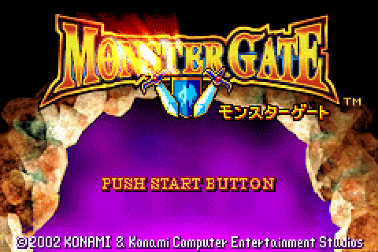
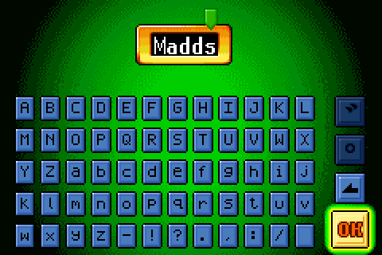
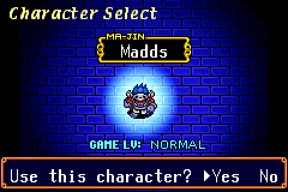
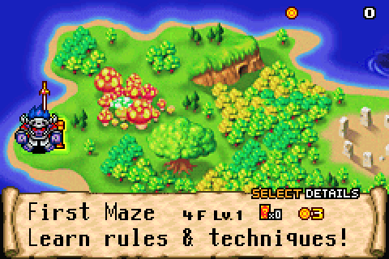
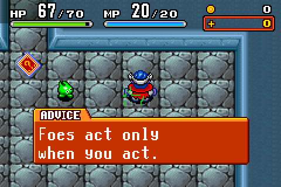

# Monster Gate (GBA) — English Translation

An unofficial English fan-translation project for Konami's *Monster Gate* (*モンスターゲート*, 2002, Game Code `ANFJ`) on the Game Boy Advance.

> [!NOTE]
> **Version 1.0.1 (Playtesting / QA):** All 2,752 game strings (554 script descriptors), 8×16 & 8×8 fonts, the character naming screen, and pre-rendered UI graphics are translated and verified. If you encounter any bugs, text clipping, or untranslated elements, please report them on the [Issues page](https://github.com/ericmaddox/monster-gate-en/issues).

---

## Screenshots

| Title Screen | Naming Screen |
| :---: | :---: |
|  |  |
| **Character Select (Boy / Ma-jin)** | **Story Dialogue** |
|  |  |
| **World Map** | **Dungeon Gameplay** |
|  |  |

---

## ROM Verification

Apply the patch **only** to a clean, unmodified Japanese *Monster Gate* (`ANFJ`) GBA ROM matching these exact checksums:

| Property | Clean Japanese Base ROM | Patched English ROM (`v1.0.1`) |
| --- | --- | --- |
| **Game Title / Code** | `MONSTERGATE1` / `ANFJ` | `MONSTERGATE1` / `ANFJ` |
| **File Size** | `8,388,608` bytes (8 MB) | `16,777,216` bytes (16 MB) |
| **CRC32** | `5B8AAA03` | `C961CE21` |
| **MD5** | `BA1F2CD7D4EB41792103BF0A95FC0C09` | `B86BAB652455C537EE2F4C6A7EFB524B` |
| **SHA-1** | `4649710EB75181573D10AD059B3BC6270508CE3D` | `9BA2287F183CEC52A51DC463DE4F07CD9EAB4BBD` |

---

## Patching Instructions

1. Download the latest release (`v1.0.1`) from [Releases](https://github.com/ericmaddox/monster-gate-en/releases) (or extract `patches/monster_gate_en_v1.0.zip`).
2. Use [Flips (Floating IPS)](https://www.romhacking.net/utilities/1040/) or [RomPatcher.js](https://www.marcrobledo.com/RomPatcher.js/) to apply **`monster_gate_en.bps`** (recommended, includes source/target CRC32 validation) or `monster_gate_en.ips` to your clean Japanese ROM.
3. Verify the resulting ROM matches the **Patched English ROM** checksums above, then load it in an accurate GBA emulator such as [mGBA](https://mgba.io/).

---

## Technical Overview

- **ROM Expansion:** Expanded from 8 MB to 16 MB (`0x08800000`–`0x08FFFFFF`), header checksum updated (`0xBD = 0x43`).
- **Text Engine (`0x800000`–`0x81AE0E`):** All 554 script descriptors / 2,752 strings relocated to expanded ROM space with updated local glyph maps and line-width constraints.
- **Font Engine:** Patched 8×16 (`0x4EDD1C`) and 8×8 outlined (`0x4F7D48`) 4bpp fonts with lowercase `a`–`z` and English punctuation.
- **Character Naming Screen (`0x880000`):** Custom English tile bank, BG0/BG1 tilemaps, 60-byte keyboard matrix, and translated default player names.
- **UI Graphics (`0x890000`–`0x8AFCC0` & In-Place):** Translated pre-rendered OBJ sprite sheets and BG tile banks covering menus, intro/ending cutscenes, tutorial `ADVICE` tab, all 133 card & monster preview headers, castle nameplates, pause/battle-over banners, and ranking screens.

---

## Repository Contents

- `patches/monster_gate_en_v1.0.zip` — Release archive containing `.bps` and `.ips` patches
- `text/` — Raw Japanese text dump (`raw_dump.json`) and categorized English translations (`01_items_cards.json`, `02_monsters.json`, `03_dialogue.json`, `04_system_ui.json`, `all_strings.json`)
- `font/` — Extracted/patched 8×16 and 8×8 font binaries, glyph tables, and contact sheet
- `graphics/` — Generated English naming-screen tile bank (`keyboard_tiles.bin`)
- `release_notes.md` — Release changelog and technical notes

---

## Legal Disclaimer

This repository contains **no** copyrighted game data or ROM files. You must supply your own legally obtained Japanese *Monster Gate* ROM to apply the patch.
