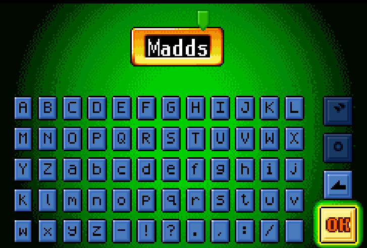

# Monster Gate (GBA) — English Translation Release Notes (`v1.0.1`)

An unofficial English fan-translation for **Monster Gate** (*モンスターゲート*, 2002, Game Code `ANFJ`), developed by Konami / KCE Studios for the Game Boy Advance.

---

## What's Fixed in `v1.0.1`

- **Fixed Character Naming Screen Rendering ([#3](https://github.com/ericmaddox/monster-gate-en/issues/3)):**
  - Preserved native 4bpp indices on `BG0` and `BG1` without RGB re-quantization, eliminating black jagged artifacts around the name-entry box and preserving all non-key UI tiles (`OK`, backspace, borders).
  - Restored `BG1` key glyph layer (`0x0C9C80`) so the active hovered key remains visible above the cursor.
  - Corrected key button vertical alignment (`by = r * 20 + 60`) and tilemap bounds (`7 <= r <= 19`) so all 60 keys and Row 4 bottom borders render cleanly.
  - Refined `5×7` glyphs for `l` and `q` for clear legibility.
  - *Note: The two darkened `゛` / `゜` modifier buttons on the right are disabled remnants from the Japanese kana keyboard and have no function in English.*

---

## What's Included

- **Complete Script Translation:** All **2,752 strings across 554 descriptors** (items, cards, monsters, dungeons, menus, NPC dialogue, and cutscenes) translated and formatted to fit GBA text box constraints.
- **Font Engine:** Patched 8×16 (`0x4EDD1C`) and 8×8 outlined (`0x4F7D48`) 4bpp fonts with full English uppercase, lowercase (`a`–`z`), and punctuation.
- **Character Naming Screen:** Custom English keyboard tile bank (`0x880000`), updated BG0/BG1 tilemaps/matrix, and translated default names.
- **Pre-Rendered UI Graphics:** Translated OBJ sprite sheets and BG tile banks for mode/character/file select, options, intro/ending cutscenes, card shop, pre-dungeon deck setup, castle nameplates, tutorial `ADVICE` tab, all 133 card & monster preview headers, pause/battle-over banners, and ranking screens.
- **16 MB ROM Expansion:** Expanded from 8 MB to 16 MB (`0x08800000`–`0x08FFFFFF`) with updated GBA header checksum (`0x43`).

---

## ROM Checksums

- **Required Clean Base ROM:** `8,388,608` bytes (8 MB)
  - **CRC32:** `5B8AAA03`
  - **MD5:** `BA1F2CD7D4EB41792103BF0A95FC0C09`
  - **SHA-1:** `4649710EB75181573D10AD059B3BC6270508CE3D`
- **Patched English ROM (`v1.0.1`):** `16,777,216` bytes (16 MB)
  - **CRC32:** `C961CE21`
  - **MD5:** `B86BAB652455C537EE2F4C6A7EFB524B`
  - **SHA-1:** `9BA2287F183CEC52A51DC463DE4F07CD9EAB4BBD`

---

## Patching Instructions

Apply **`monster_gate_en.bps`** (recommended) or `monster_gate_en.ips` to your clean Japanese `ANFJ` ROM using:
- **Desktop:** [Flips (Floating IPS)](https://www.romhacking.net/utilities/1040/)
- **Online:** [Marc Robledo's RomPatcher.js](https://www.marcrobledo.com/RomPatcher.js/) or [Romhacking.net Patcher](https://www.romhacking.net/patch/)

---

## Playtesting & Bug Reports

Playtesting is ongoing. If you spot any bugs, text clipping, or untranslated elements, please open an issue on the [GitHub Issues page](https://github.com/ericmaddox/monster-gate-en/issues) with a screenshot or save state if possible.
